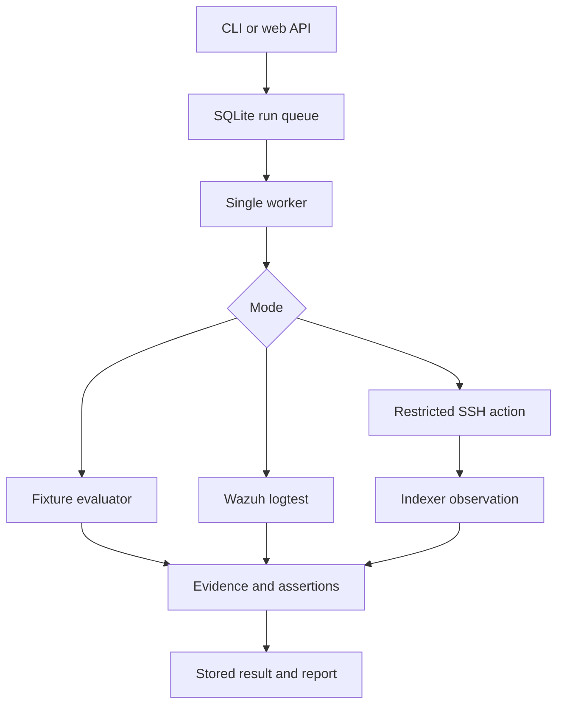

# Architecture

The core is a Python library with a CLI and a small HTTP application. SQLite stores the scenario snapshot, run state, verdict and result. Versioned scenario files are JSON so the default installation needs no parser dependency.

## Ownership of evidence

The runner records the intended action and independent execution result. Wazuh provides logtest results or indexed alerts. The evaluator tests those observations against explicit assertions. None of these components may manufacture a real alert when a service is unavailable.

Fixture mode supplies its observations from the scenario itself. Its scope remains `fixture` throughout the run, export and interface. Replay tests native Wazuh rules in an isolated session. Live uses a new path per run and constrains alert queries by endpoint identity and time; behaviour-specific predicates prevent an unrelated alert from satisfying the test.

For live modification and deletion, the executor establishes a baseline file before the measured action and waits for its added event to be indexed. This prevents an immediate create/delete cycle from being treated as a valid deletion test before the sensor has observed the file. The baseline deadline and indexer timing remain measurable integration assumptions that must be checked on the chosen Wazuh version.

## Run lifecycle

Jobs are created as queued and claimed atomically. One worker executes jobs, so stateful rules and endpoint changes do not run concurrently by default. Cancellation is persisted and communicated to the executor. Recovery marks interrupted active work as a failed execution; it does not quietly repeat an action. A durable marker set before live work prevents another live run until cleanup is verified or the operator acknowledges an external VM restoration.

The execution status answers whether the job finished. The detection verdict answers whether its expectations were met. A run may finish with FAIL or INCONCLUSIVE.

| Verdict | Meaning |
| --- | --- |
| PASS | All required assertions and available mandatory observations satisfy their expectations |
| FAIL | An expected result was contradicted or a required observed-stage result missed its deadline |
| ERROR | Configuration, transport or execution failed |
| INCONCLUSIVE | Available evidence is insufficient for the intended conclusion |
| CANCELLED | The run was stopped; any cleanup result remains part of the record |

Only PASS satisfies a required security gate. A lack of telemetry cannot turn a control into a successful negative test.

## Persistence and comparison

A run stores the scenario as submitted. Editing a JSON file does not change previous runs. Baselines hold selected completed run results, permitting a later comparison against the chosen reference. Meaningful comparisons require the same scenario identity and mode. Different versions or configuration hashes should be investigated rather than silently treated as equivalent.

Evidence hashes detect changes to a retained evidence representation. They do not prove that an endpoint or external service provided truthful data. Clock alignment, indexer lag and polling interval affect measured observation delay; reports must not call this pure SIEM processing time.

## Deliberate scope

This is a single-operator laboratory release. It does not provide a distributed worker fleet, tenant isolation, broad adversary emulation or automatic VM recovery. SQLite is suitable for the local queue and history; it is not a statement about production scale. A production service would require explicit operational requirements, stronger identity management and deployment testing.
